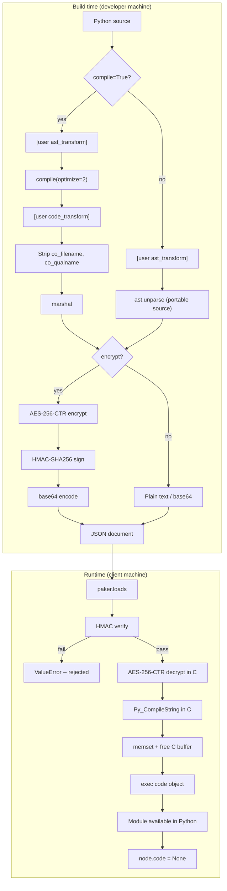
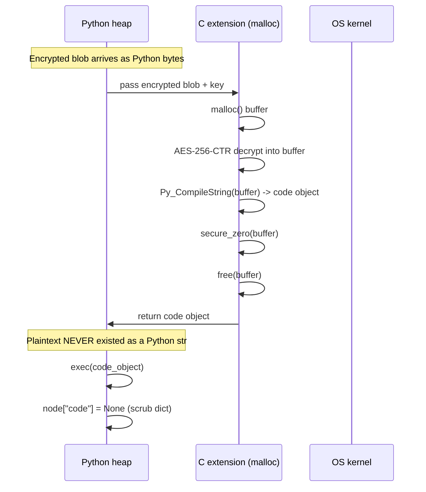

# Security Model

What paker protects, what it doesn't, and what is visible at each stage of
the pipeline.

## Protection scope

paker protects against:

1. **Casual inspection** -- opening the JSON file and reading source code
2. **Static analysis** -- scanning the bundle for strings, patterns, or credentials
3. **Memory scraping** -- heap scanners looking for plaintext source on the Python heap
4. **Unauthorized redistribution** -- extracting and reusing bundled code

paker does **not** protect against:

1. **Debugger breakpoints during decryption** -- pausing inside `_paker_crypto.c` between decrypt and memset exposes the plaintext buffer
2. **Kernel-level memory reads** -- root access to `/proc/self/mem` can read any process memory
3. **Code object marshalling** -- after `exec()`, code objects exist in memory and can be serialized with `marshal`

## Pipeline overview



## What is visible at each layer

### Layer 1: The JSON file

**Without encryption:**
```json
{
  "mymodule": {
    "type": "module",
    "extension": "py",
    "code": "def calculate(price, rate):\n    return price * rate\n"
  }
}
```
Full source visible. No protection.

**With encryption:**
```json
{
  "mymodule": {
    "type": "module",
    "extension": "pyc",
    "encrypted": true,
    "code": "vUBLLLz2D8B3z9k2wMpYtP..."
  }
}
```
Opaque base64 blob. Without the 32-byte key, the contents are indistinguishable
from random data. HMAC prevents tampering -- modifying any byte invalidates the
signature.

Running `strings` and `grep` against each bundle format:

```
$ grep -c "secret\|password\|api.key\|calculate\|merchant" bundle.json

  Plain:          14 matches
  Encrypted:       0 matches
```

Shannon entropy confirms encrypted bundles are near-random:

```
     Plain: 4.97 bits/byte  (structured text)
 Encrypted: 5.96 bits/byte  (near-maximum for base64)
```

### Layer 2: Process memory during loading



Scanning the Python heap with `gc.get_objects()` after loading an encrypted
module that contains API keys and database credentials:

```python
# Scan entire Python heap for sensitive strings
for obj in gc.get_objects():
    if isinstance(obj, str) and "sk-ant-secret" in obj:
        print("FOUND")  # never reached
```

**Result:** no sensitive strings found. The C-level decryption path means
plaintext source never exists as a Python `str` object.

The encrypted source is also scrubbed from paker's internal dict after import:

```python
>>> modules["my_module"]["code"]
None  # removed after successful import
```

### Layer 3: The loaded code object

After `exec()`, the module is live in the interpreter. Inspecting it with
standard tools:

```python
>>> import inspect
>>> inspect.getsource(protected_module)
TypeError: <module 'protected_module' (paker://protected_module)> is a built-in module

>>> inspect.getfile(protected_module)
TypeError: <module 'protected_module' (paker://protected_module)> is a built-in module

>>> inspect.getsourcelines(protected_module.some_func)
OSError: could not get source code
```

All `inspect` methods are blocked. paker modules appear as built-in modules
with no source file on disk.

With `strip_metadata=True` (the default), `co_filename` and `co_qualname` are
blanked on all code objects, so decompiled output doesn't leak the packager's
local paths.

### Layer 4: Native extensions (.so / .pyd)

```mermaid
flowchart LR
    subgraph Linux
        A1[Encrypted .so in JSON] --> B1[Decrypt in C]
        B1 --> C1[memfd_create]
        C1 --> D1[Write to anonymous fd]
        D1 --> E1["dlopen(/proc/self/fd/N)"]
        E1 --> F1[Module loaded]
        Note over C1,D1: Zero disk writes
        Note over D1: fd shows as 'memfd:' in /proc
    end

    subgraph macOS
        A2[Encrypted .so in JSON] --> B2[Decrypt in C]
        B2 --> C2[Write to tmpdir]
        C2 --> D2[dlopen]
        D2 --> E2[unlink immediately]
        E2 --> F2[Module loaded]
        Note over C2,E2: File exists for milliseconds
        Note over C2: Random name, no extension
    end

    subgraph Windows
        A3[Encrypted .pyd in JSON] --> B3[Decrypt in C]
        B3 --> C3[VirtualAlloc]
        C3 --> D3[Map PE sections]
        D3 --> E3[Resolve imports]
        E3 --> F3[Module loaded]
        Note over C3,D3: Zero disk writes
    end
```

Native extensions are standard compiled binaries. Once loaded into memory they
can be analyzed with tools like Ghidra or IDA Pro, the same as any `.so` or
`.dll`. paker's protection for native code is about the delivery channel
(encrypted, zero-disk), not the binary itself.

## Crypto details

### Algorithm: AES-256-CTR + HMAC-SHA256 (Encrypt-then-MAC)

```
Encryption:
  master_key (32 bytes, user-provided)
  |-- HMAC-SHA256(master_key, "paker-enc-v1") -> enc_key (32 bytes)
  +-- HMAC-SHA256(master_key, "paker-mac-v1") -> mac_key (32 bytes)

  nonce = random(16 bytes)
  ciphertext = AES-256-CTR(enc_key, nonce, plaintext)
  mac = HMAC-SHA256(mac_key, nonce + ciphertext)
  output = base64(nonce + ciphertext + mac)

Decryption:
  mac_check = HMAC-SHA256(mac_key, nonce + ciphertext)
  if mac != mac_check -> reject (ValueError)
  plaintext = AES-256-CTR(enc_key, nonce, ciphertext)  <- happens in C
```

**Why separate keys:** using the same key for encryption and authentication
is a cryptographic anti-pattern. HKDF-style derivation with distinct labels
ensures the keys are independent.

**Why CTR + HMAC instead of GCM:** AES-GCM requires a GHASH implementation
(~200 lines of GF(2^128) arithmetic). CTR + HMAC provides the same security
guarantees (IND-CCA2) with simpler, more auditable code. The AES implementation
is vendored from [tiny-AES-c](https://github.com/kokke/tiny-AES-c) (public domain).

**Nonce:** 16 random bytes per module. Birthday collision at ~2^64 encryptions.

### Memory scrubbing

The C extension uses a `secure_zero` function that writes through a `volatile`
pointer, preventing the compiler from optimizing away the zeroing:

```c
static void secure_zero(volatile void *ptr, size_t len) {
    volatile unsigned char *p = (volatile unsigned char *)ptr;
    while (len--) { *p++ = 0; }
}
```

Scrubbing targets:
- AES context after decryption
- Plaintext buffer after `Py_CompileString`
- Plaintext buffer after `PyBytes_FromStringAndSize`

**Not scrubbed** (by design):
- The code object returned to Python -- it must survive for execution
- The encrypted blob -- it's opaque without the key
- Function parameters (`bytes` objects are immutable in CPython)

## Protection summary

| Scenario | Protection | Notes |
|---|---|---|
| Reading the JSON file | Full (with encryption) | AES-256 + HMAC |
| `strings` on the JSON file | Full (with encryption) | Ciphertext is random noise |
| Heap scanning for source code | High | Plaintext in C buffer only, zeroed after use |
| `gc.get_objects()` inspection | High | Source never exists as Python str |
| `inspect.getsource()` | Full | Returns error (no source file) |
| Debugger breakpoint during decrypt | None | Plaintext visible in C buffer briefly |
| `marshal.dumps(func.__code__)` | Low | Produces standard bytecode |
| Disassembling native extensions | Low | Standard binaries, Ghidra/IDA work normally |

## Recommendations

**For maximum protection:**
```python
paker.dumps("my_package", key=key, include_deps=True)
```

**For defense-in-depth:** combine paker with Cython compilation. Compile
proprietary `.py` files to `.so` with Cython, then bundle them with paker.
This requires both the decryption key and reverse engineering skills for native
binaries.
